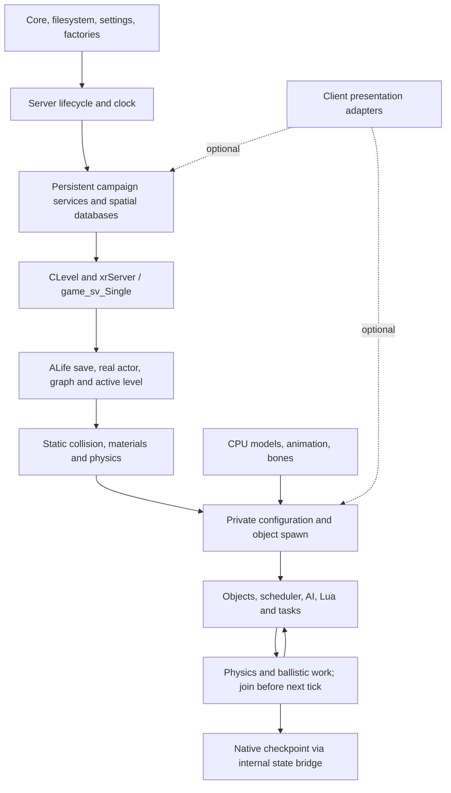

# Minimum headless campaign service boundary — S02-T01

Completed source mapping, 2026-10-17. Source is the clean accepted checkout
`builds/build_1/engine-work`, revision
`c57fe5b9fab4fe0506659db03137c52d2500eb2f`. Source references below are relative
to its `src/` directory. These are source observations and proposed implementation
contracts, not a headless build or runtime result. [Validation](validation/S02-T01.md)
records the checks. [plan.md](../plan.md) and D1–D8 govern implementation.

## Boundary and ownership

The dedicated process must own `CLevel`, required `game_cl_Single` services,
`xrServer`/`game_sv_Single`/ALife, online objects, scheduler, physics, AI, Lua,
task state and CPU assets. Its internal direct connection is a private simulation
bridge. It is not an external player session. Renderer, input, menu, loading-screen
and audio-output capabilities need separate selection from campaign capability.

Use a distinct campaign-server role in S02-T02; do not equate it with
`g_dedicated_server`, `DEDICATED_SERVER`, or `DEDICATED_SERVER_ONLY`. Keep
`NO_SINGLE` absent. The old flags both suppress required services and leave
graphics calls reachable (B01–B07 below). A role definition alone is an
intermediate build milestone; renderer-free execution remains S02-T05/G02.

The diagram describes service dependencies. The staged startup below describes
the existing call sequence; ALife can initialize before online physics exists.

## Startup through first tick: inspected source

| Ref | Source and function | Observed dependency; intended seam |
|---|---|---|
| B01 | `xrEngine/no_single.h:1-7`; `xrGame/game_sv_single.cpp:15-35`, `game_sv_Single::Create` | `DEDICATED_SERVER_ONLY` implies `NO_SINGLE`; that excludes `/alife` simulator construction. Retain SP campaign factories and ALife in the new role. |
| B02 | `xrEngine/x_ray.cpp:1137-1142`, `1179-1197`, startup entry; `xrEngine/EngineAPI.cpp:215-249`, `Initialize`; `xrEngine/Device_create.cpp:158-181`, `209-247`, `ConnectToRender/Create` | Engine/input/console initialization precedes renderer selection, renderer connection and `Startup`. `Device.Create` still queries monitors and calls the render device. Separate core/clock/factories from window, input and graphics creation. |
| B03 | `xrEngine/x_ray.cpp:578-586`, `636-663`, `Startup`; `xrEngine/device.cpp:653-689`, `Run`; `xrEngine/IGame_Persistent.cpp:34-58`, `87-105`, constructor/`OnAppStart`; `xrGame/GamePersistent.cpp:156-182`, app lifecycle | Sound initialization and user config precede device creation; application, persistent state and spatial databases precede the loop. Persistent state owns environment data and frame registration. Retain app-start material library/game globals/configuration; split environment data from render resources. `Device.Run` dispatches app start/end but also clears a render target and raises a window; the server lifecycle must retain the former explicitly. No Discord/ReShade or interactive startup dependency in the final server. |
| B04 | `xrEngine/x_ray.cpp:1396-1470`, `CApplication::OnEvent`; `xrEngine/IGame_Persistent.cpp:167-200`, `OnGameStart/Prefetch`; `xrGame/Level.cpp:230-279`, constructor | Start event calls `PreStart`, creates level, calls persistent `Start`, then `net_Start`. Level construction omits task/map/restriction/spawn services under the old runtime flag but unconditionally creates player HUD and may start model-prefetch work. Preserve gameplay managers; split HUD and GPU prefetch. |
| B05 | `xrGame/Level_start.cpp:31-99`, `107-230`, `net_Start/net_start1–4`; `xrGame/Level_network_start_client.cpp:52-68`, `net_start_client2`; `xrGame/alife_graph_registry.cpp:49-96`, `update/setup_current_level` | Queued startup creates SP `xrServer`, connects campaign, then inserts internal client stages. ALife chooses the level through its real actor graph vertex and loads AI graph. Direct client creation pumps receive/server update until configured. Replace unbounded waits with stage deadlines and named failure logs; retain private bridge ownership. |
| B06 | `xrGame/Level_network_start_client.cpp:80-164`, `net_start_client3/4`; `xrEngine/IGame_Level.cpp:88-148`, `Load`; `xrGame/Level_load.cpp:24-47`, `Load_GameSpecific_Before` | Level config/header/static collision load before physics creation. Level load also creates HUD, calls `Render->level_Load`, loads environment modifiers, objects and registers frame callback. Preserve CPU CFORM/material mapping and AI/restrictions; detach render level and HUD work. `bReady` alone does not mean all spawn/configuration stages finished. |
| B07 | `xrGame/Level_start.cpp:340-363`, `InitializeClientGame`; `xrGame/Level_load.cpp:50-194`, `Load_GameSpecific_After`; `xrGame/game_cl_single.cpp:23-44`, `50-100` | Configuration constructs native client game state, initializes it, then calls the after-load hook. That hook mixes particles/sound, level-script creation, environment time and HUD; old runtime dedicated flag skips script creation. Retain time and script services; separate UI creation/difficulty's global-actor call. The after-load call is in configuration, not the commented-out call in `IGame_Level::Load`. |
| B08 | `xrGame/Level_network_start_client.cpp:211-280`, `net_start_client5/6`; `xrGame/Level_start.cpp:233-260`, `net_start5/6` | Texture upload, connection synchronization, HUD, `game->OnConnected`, precache, local-player ready export and bullet load finish startup. Explicitly distinguish internal protocol `local_player` from a human/view actor. Readiness requires configuration, spawn completion, physics and CPU assets, and balanced loading events; no camera precache or keypress in final server. |

## CPU, presentation and mixed services

| Ref / classification | Source and function | Contract and task owner |
|---|---|---|
| B09 — mixed clock/loop | `xrEngine/device.cpp:401-430`, `451-495`, `553-571`, `694-754`, `on_idle/FrameMove`; `xrEngine/x_ray.cpp:1511-1542`, `1560-1575`, loading | Loading executes one queued event and calls `LoadDraw`; that invokes `Device.Begin/End` even for runtime dedicated mode. FrameMove changes time and processes callbacks; outer loop accesses render matrices/grass and drains workers. S02-T04 owns clock/job dispatch; S02-T05 replaces loading UI with progress/state logging, retaining the loading queue and reference count. |
| B10 — mixed persistent/scheduler | `xrEngine/IGame_Persistent.cpp:264-295`, `OnFrame`; `xrGame/GamePersistent.cpp:703-735`, `817-824`, `OnFrame`; `xrEngine/x_ray.cpp:1606-1614`, `CApplication::OnFrame` | App callback updates events/spatial DBs/hearing. Persistent frame has menu/UI/particles/environment before scheduler. Keep `Engine.Sheduler.Update` exactly once per advancing frame; extract campaign/environment values needed by simulation. Do not call all of persistent frame through a null menu. S02-T04/T05. |
| B11 — CPU with view-dependent policy | `xrEngine/IGame_Level.cpp:191-208`, `OnFrame`; `xrEngine/xr_object_list.cpp:198-266`, `Update`; `xrEngine/xr_object.cpp:379-406`, `UpdateCL/shedule_Update`; `xrGame/Level.cpp:976-1056`, `OnFrame` | Keep object `UpdateCL`, spatial updates, destruction and scheduler registration. HUD/ambience are separate. Initial fixture updates all active online objects; merely setting `rsDisableObjectsAsCrows` once fails because SP `CLevel::OnFrame` resets it. Explicit server policy must replace that assignment. S02-T04. |
| B12 — CPU physics | `xrPhysics/PHWorld.cpp:185-200`, `Create`; `280-295`, `OnFrame`; `506-556`, `FrameStep`; `xrEngine/device.cpp:902-917`, frame registration | Physics owns an accumulator and `fixed_step`; `AddSeqFrame` selects main/MT callbacks. Retain native substeps, contact/material data, step callbacks and commanders. One driver owns the call; unregister legacy callback if calling directly. Do not substitute network rate for physics step. S02-T04. |
| B13 — CPU AI/ALife/time | `xrGame/alife_update_manager.cpp:59-84`, `92-140`, constructor/update/scheduled update; `xrGame/ai/stalker/ai_stalker.cpp:1129-1155`, `shedule_Update`; `xrGame/ai/monsters/basemonster/base_monster.cpp:363-393`, `shedule_Update`; `xrGame/alife_time_manager_inline.h:23-26`, `game_time` | Keep online AI, offline scheduled work and switching, plus ALife's time factor over Device time. ALife work may queue on `seqParallel`; scheduling alone is insufficient without executing it. The graph actor/level anchor is campaign data. S02-T04/T06; two-actor activation remains S03-T04. |
| B14 — mixed models/bones | `xrEngine/xr_object.cpp:70-85`, `255-280`, visual setter/spawn; `xrGame/CharacterPhysicsSupport.cpp:184-205`, `in_NetSpawn`; `Layers/xrRender/ModelPool.cpp:100-163`, `Instance_Load`; `Layers/xrRender/SkeletonCustom.cpp:164-180`, `Load`; `Layers/xrRender/SkeletonAnimated.cpp:772-785`, `Load` | Object spawn requests renderer-owned models for skeleton collision and shells. CPU asset provider must retain real model instances, hierarchy, motion data, bone shapes, transforms and callbacks; missing model is an explicit error. Separate shared assets from per-object bone/blend state; keep model data alive until objects, cforms and shells release it. S02-T03. |
| B15 — mixed GPU/model evaluation | `Layers/xrRender/FVisual.cpp:123-147`, `174-200`, `Load`; `Layers/xrRender/SkeletonRigid.cpp:23-80`, `CalculateBones`; `xrGame/GamePersistent.cpp:120-149`, `RegisterModel` | Vertex/index allocation reaches GPU; bone evaluation also consults view/frustum and screen size under `OPTIMIZE_CALCULATE_BONES`. Preserve CPU geometry required by collision/ray queries, bone material IDs and animation evaluation. Remove camera throttling for fixture gameplay bones, including its override of `bForceExact`; do not return a dummy visual or identity bones. S02-T03. |
| B16 — mixed tasks/Lua/map | `xrGame/Level.cpp:1034-1053`, `1142-1169`, `OnFrame`; `xrGame/GametaskManager.cpp:161-205`, `UpdateTasks`; `xrGame/game_cl_single.cpp:41-44`, difficulty | Task and level-script updates/GC are skipped by the old flag. `UpdateTasks` also disables map pointers and updates active-task presentation. Retain task evaluation/effects and map data/callbacks required by scripts; isolate pointer/UI operations. Supply the real campaign actor explicitly for fixture mutations. S02-T05/T06; complete participant/Lua API remains Stage 3. |
| B17 — mixed ballistics | `xrGame/Level_Bullet_Manager.cpp:186-225`, `Load`; `1225-1272`, `CommitRenderSet/CommitEvents`; `xrGame/Level.cpp:992-1016`, `1146-1150`, `OnFrame` | Load physical coefficients/materials even with no tracer/whine rendering. `CommitRenderSet` schedules `UpdateWorkload`; preserve that job and next-frame event commit including Lua hit callbacks. Only tracer copies/draws and proven presentation effects are removable. Keep physical hit, damage and collision work. S02-T04/T05. |
| B18 — mixed sound | `xrEngine/IGame_Level.cpp:75-79`, `_sound_event`; `265-352`, `SoundEvent_Register/Dispatch`; `xrEngine/x_ray.cpp:144-153`, sound processor | Hearing registration and dispatch require `S->feedback`; they use source position, max AI range, volume, occlusion and destination lifetime. A silent backend returning no feedback silently loses hearing. Provide CPU sound-event metadata/lifetime/occlusion independent of playback; world-space stimuli cannot use a fabricated camera listener. S02-T05; broad audio/content coverage deferred. |
| B19 — CPU checkpoint with internal bridge | `xrGame/alife_storage_manager.cpp:46-123`, `216-250`, save/load/preparation; `xrGame/Level_network.cpp:294-312`, `322-348`, `Send/net_Update` | Checkpoint preparation calls internal `ClientSend/ClientSave`; network processor also drives `Server->Update`. Retain native state collection and save callbacks after jobs finish. Do not expose this state-writer endpoint externally. No crash/journal guarantee until Stage 7. S02-T06. |

All unclassified callbacks encountered in implementation must be traced before
suppression. In particular, installed Lua, particles and environment callbacks
can mutate gameplay. Repository source alone does not establish their behavior.

## Explicit execution and lifecycle contract

Proposed order for the initial serial fixture follows the existing non-MT callback
priorities: application HIGH+1000 (`xrEngine/x_ray.cpp:1359-1362`), persistent
HIGH+1 (`xrEngine/IGame_Persistent.cpp:34-40`), level NORMAL (B06), physics LOW
(B12), network LOW−2 (B06). Registrator comparison is descending priority in
`xrEngine/pure.h:48-53`. Existing MT physics/network can have a different order;
this is a proposed serial validation configuration, not a claim of measured parity.

1. Initialize core, explicit filesystem roots, logging/settings, event/factory
   services and a monotonic simulation clock. Keep SP factory availability.
   Construct persistent services and spatial DBs before campaign startup. Prepare
   CPU model/material and sound-stimulus services before online spawning.
2. Run staged campaign start with the preserved real save actor/ALife graph.
   Load static collision/AI data, create physics, then finish private game-state
   configuration and spawns. Assert all managers exist before any first-tick
   readiness marker. Give loading progress its own counter; load-screen calls
   must not masquerade as simulation ticks. Gate partial initialization safely.
3. Each tick advances a single clock, processes engine events/spatial/hearing,
   then persistent campaign work and scheduler (including online AI and ALife).
   Preserve native scheduling budgets and record elapsed/actual work separately.
4. Level work commits previous ballistic events, receives private messages,
   processes spawn/game events, evaluates tasks, updates objects, world/environment
   time, level scripts and physics commanders; then runs/queues ballistic workload
   and required GC. Preserve the within-level ordering in B11/B16/B17.
5. Run native physics accumulator/substeps, then private state export/server
   update. Finish queued work before advancing time, checkpointing or releasing
   entities. For the initial serial fixture disable MT producers consistently;
   instrument accidental queued jobs and drain them exactly once at the documented
   boundary. Future worker use requires measured ordering and explicit joins.
6. S02-T04 must choose/log tick budget and bounded catch-up based on measurement,
   preserving `fixed_step` and coherent integer/float/world clocks. An injected
   long frame must report carried debt or explicit clamping; never silently
   advance ALife by wall time while dropping corresponding simulation time.
   Pause is an explicit server lifecycle state, independent of window focus/menu.
7. On stop: reject new fixture commands; finish pending jobs; optionally save at
   the stable boundary. Quiesce loading/prefetch/physics/network callbacks while
   preserving services used by object destruction. Drain/remove objects with
   native lifecycle work, disconnect private client and server/ALife, then destroy
   physics and level managers/AI graph, and finally persistent/model/sound/spatial
   services and core. Missing/failed startup stages unwind only initialized owners.

Existing shutdown evidence: `xrGame/Level_network.cpp:31-107`, `121-171`,
`remove_objects/net_Stop`; `xrGame/Level.cpp:287-352`, destructor;
`xrEngine/IGame_Level.cpp:35-71`, destructor/`net_Stop`;
`xrEngine/x_ray.cpp:1450-1470`, disconnect, and `672-696`, outer teardown.
Objects are removed while physics/model/script services still exist. ALife
unregisters scheduled/parallel work (B13). The existing prefetch destructor
signals exit after deleting queues (`Level.cpp:331-338`); S02-T02 must establish
worker completion before freeing owned queues rather than treating this path as
proof of safe shutdown. This is an ordering concern from source, not a reproduced
crash. S02-T03/05 must pair any separated resource creation with its release path.

## Minimal real campaign fixture H02-F01

Input identity is [headless-fixture.json](headless-fixture.json). Use a fresh
workspace runtime under `builds/stage2/test-install/H02-F01/<run>` with isolated
appdata/tmp/logs. Reuse independently copied accepted archives and matching
overlay from G01; verify their manifests before use. Never point writable aliases
at the original installation, tested client, or preserved evidence. Copy the
preserved `player - autosave.scop` and `.scoc` together into that run's save path;
keep its basename for initial compatibility. Screenshot `.dds` is presentation.

The snapshot log records autosave load and `k00_marsh` geometry. This suggests
Marsh as the fixture level; the authoritative loaded save's graph/level and actor
ID must be recorded and checked at runtime. The snapshot is a candidate, not a
proven headless fixture; its hash pins the input without claiming it is a tiny
world. Preserve offline ALife and bound execution to 300 advancing frames after
readiness, with a 300-second startup watchdog and 60-second run watchdog initially.
Timeout is failure, not readiness. Report actual elapsed time and tune documented
limits only with evidence.

The save's actor is a real campaign entity with its existing inventory/condition
and graph location. The process supplies explicit simulation context for it and
sets no presentation view/control entity merely to satisfy a null dereference.
Instrument/replace the minimum global-actor dependencies reached by this fixture;
record each adapter. Do not create a synthetic ASPLAYER entity, silently select
Player 1, or declare Stage 3 complete. Keep the existing SP actor accessor for SP.
Native load currently verifies an ALife actor (B19); zero external clients is
compatible with that real saved actor. Failure to separate view and campaign
context is a concrete blocker for G02.

| Assertion | Required observation and failure condition | Owner |
|---|---|---|
| H01 Identity/isolation | Log source/patch/build/config/save hashes, resolved aliases, loaded level/real actor and external client count zero. Reject a missing input/hash mismatch or writable alias outside the new run. | T02, T06 |
| H02 Campaign construction | SP game state and initialized ALife, task/map/restriction/spawn services and level script process exist; no `NO_SINGLE` in effective compilation. Log stage transitions and clean partial-start unwind. | T02 (role, macros, services, unwind); T05/T06 (construction, moved 2026-10-18) |
| H03 No graphics/presentation | Zero attempts to create graphics devices/swap chains, upload GPU assets or submit draws through startup/run/shutdown; no interactive input, menu or view actor needed. Instrument both engine entry points and native API calls, including software GPU fallback. A hidden window or zero visible frames is insufficient. | T03, T05 |
| H04 Tick/scheduler/AI/ALife | Record frame/clock and callback sequence; object update, scheduler dispatch, an identified online NPC's scheduled/planner work, ALife switch and offline scheduled work all advance. Name affected entity IDs; empty queues/counters alone cannot pass. Move a fixture NPC through a short reachable path and record arrival. | T04, T06 |
| H05 CPU assets/bones | Record real actor and selected NPC model/motion paths and hashes, bone count, root and one animated bone transform/callback. Compare same pose/time to a matched client CPU capture (initial tolerance 1e-4 per matrix component); require finite nontrivial animation. Missing assets or identity-only replacement fails. | T03 |
| H06 Collision/physics | Pin one native movable shell and level floor query, starting position/velocity, material/bone IDs and step count; observe gravity, collision and settling. Compare equivalent isolated setup to client CPU capture (initial position tolerance 0.01 world units); record native `fixed_step` and test duration. | T03, T04 |
| H07 Ballistics | Submit one fixture shot with explicit real source/weapon/target context; record workload, intersection/bone/material, event commit and exactly one intended hit effect. No `OnRender` invocation. Require previous-work/next-commit ordering; counters without a hit fail. | T05 |
| H08 Lua/tasks/hearing | Run one harmless explicit-actor Lua probe and native task condition evaluation; observe an identified NPC receiving a positioned stimulus with correct source/range/occlusion without playback. Preserve installed level scripts; failures are surfaced. Full quest rewards remain waived/untested. | T05, T06 |
| H09 Time and checkpoint | Advance world time consistently; save through native state gathering after jobs complete. Restart from new output and compare actor health, item IDs/ammo, level/graph, time and probe/task state. Do not use byte equality of compressed saves as a state test. | T06 |
| H10 Lifecycle and clocks | Exercise startup failure, normal stop, restart and an injected long frame. Verify no duplicate callbacks/jobs, dangling scheduled/physics/model users or view-dependent pause. Record bounded catch-up policy and remaining debt. Matched SP smoke must still pass. | T02, T04, T06 |

Exact NPC/model/motion/shell/shot parameters and meaningful task/probe state are
to be captured by the owning implementation task before its acceptance run.
Choose an existing suitable entity from the loaded snapshot and persist its
identity/initial state; absence blocks that assertion. Do not turn a missing
encounter into a passing zero count. These are specified assertions, none run yet.

## Implementation handoff and limits

S02-T02 can now begin with the clean checkout and root-owned patch series:
introduce a distinct role/target, inspect evaluated macros across dependencies,
retain campaign managers, define internal bridge and staged initialization/stop
logging, and build both products. Its smoke harness should report the last
supported initialization phase and fail honestly on graphics/context blockers.
Full CPU extraction and clock work follow in T03/T04; final boot/campaign fixture
remain T05/T06. No task reordering or change to D1–D8 is required by this map.

Remaining unknowns are installed Lua dependencies reached by the fixture, complete
CPU mesh/motion/hit data extraction, sound metadata without playback, actor-view
separation, and runtime scheduling/teardown behavior. They are bounded follow-up
work, not evidence of an impossible architecture. No binary mismatch required
reopening Ghidra. Quest/reward persistence and original-client equivalence remain
the two explicit G01 waivers; this mapping does not resolve them.

## Corrections from implementation (2026-10-18)

Source tracing during S02-T05a/b corrected several rows above; the originals are
kept as the pre-implementation map.

- **B03/B04.** Constructing the persistent object crashes before `OnDeviceCreate`:
  the `dxEnvironmentRender` constructor itself creates two textures
  (`Layers/xrRender/dxEnvironmentRender.cpp:207-211`). The first `CLevel`
  crash is `IGame_Level`'s constructor calling `Device.DumpResourcesMemoryUsage`
  (`xrEngine/IGame_Level.cpp:31`), not `player_hud`. `CDebugRenderer` is trivial.
  The spawn-prefetch thread always starts natively but stays idle until
  `g_bootComplete`; the campaign server does not start it.
- **B05.** The level's AI graph loads inside `Server->Connect` (`net_start2`),
  through `CALifeGraphRegistry::setup_current_level` → `pApp->Level_ID` →
  `ai().load` (`xrGame/alife_graph_registry.cpp:66-96`). `SLS_Default` switches
  ALife objects online immediately. `restart_all` re-initialises the script
  engine, and installed scripts create particles and sounds during that load.
- **B06.** Creating the HUD alone crashes with no device (`CHitMarker` shaders).
  `Render->level_Load` is entirely presentation (shaders, sectors, lights,
  details, HOM); gameplay needs none of it. Hearing occlusion is `level.som`,
  loaded in `Load_GameSpecific_After`, not the CFORM.
- **B07.** The after-load hook runs inside `net_start_client6`'s synchronisation
  pump, when the server's configuration message arrives.
- **B08.** `M_CLIENTREADY` is a no-op on `game_sv_Single`. Spawn messages are
  processed on the first `CLevel::OnFrame`, and `M_SPAWN` received before
  `bReady` is dropped.
- **B09.** The native idle loop never pumps loading events while the device is
  not ready (`xrEngine/device.cpp:405-409`); the campaign server pumps
  `g_loading_events` itself with a deadline.
- **B10.** `CGamePersistent::OnFrame` skips the scheduler until the level is ready
  and while paused; the campaign clock runs the scheduler every tick in the
  persistent slot instead and never registers the persistent frame.
